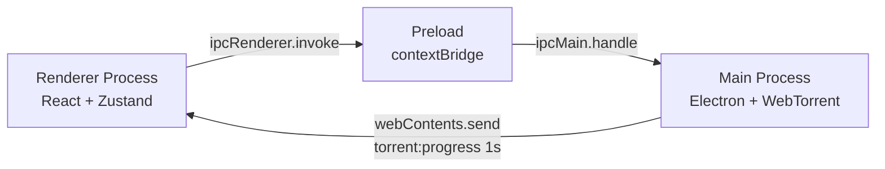

# Meshy Torrent

Cross-platform desktop BitTorrent client built with Electron, React, and WebTorrent.

O [roadmap para a versão 1.0.0](docs/ROADMAP.md) define os próximos marcos e os critérios
de lançamento da primeira versão estável. O [roadmap pós-1.0](docs/ROADMAP_POST_1_0.md)
detalha a evolução planejada de funcionalidades e plataformas.


---

## 1. Description

Meshy Torrent is a desktop BitTorrent client with a modern interface inspired by VS Code — dark theme,
Activity Bar navigation, and a keyboard-friendly layout. It runs on **Windows**, **macOS**, and
**Linux** via Electron, using WebTorrent as the download engine and React for the UI.

### Features

- Add torrents via `.torrent` file, magnet link, or drag-and-drop
- Pause, resume, and remove downloads
- Per-file selection within a torrent
- Pre-start review: files, selected size, and per-download destination folder
- Free disk space check that accounts for active and queued downloads on the same volume
- Pause on low disk space, preserving data and file selection for manual resume
- Locate, move, and verify existing files, resuming only the pending content
- Open magnets and `.torrent` files from the OS, always going through the review step
- Option to keep downloading in the system tray, with controls to pause, resume, and quit
- Lightweight connection mode with a quick toggle, its own speed limits, and per-weekday schedules
- Batch selection and actions, multi-import with per-entry review and individual results
- Explanations and actions for queued, no-peers, tracker-error, and unavailable-folder states
- Configurable download/upload speed limits and maximum concurrent downloads
- Real-time progress, speed, and peer count updates (pushed every second)
- Session persistence — downloads are restored on relaunch
- Per-torrent tracker management and global tracker favorites
- Native OS notifications on download completion
- Customizable themes with dynamic application via CSS variables
- Internationalization: `pt-BR` and `en-US`
- Updates via GitHub Releases on Windows x64, in signed distributions,
  with automatic download and user-confirmed restart
- Advanced network settings: DHT, PEX, uTP

When adding a torrent, Meshy Torrent first fetches only its metadata. Choose the files and destination
folder in the review step and confirm with **Start download**. For multiple entries, each torrent
gets its own confirmation. The selection and folder are preserved when the app is reopened.

Disk protection keeps a 64 MiB margin and checks available space before starting or resuming,
including when leaving the queue. During transfer, a new check runs every five seconds; an
`ENOSPC` error also triggers a pause. Free up space or reduce the selection before resuming.

Use **Files…** on a torrent to verify integrity, locate a reorganized folder, or move the data
to another disk. The operation pauses the torrent; once finished, resume to download pending
content. To locate `Package/file.bin`, choose the folder containing `Package`. Moves do not
overwrite files at the destination. Originals are removed only after the copy, verification, and
persistence of the new path; files shared with other torrents are kept. The file catalog is also
preserved so completed downloads can be opened after a restart.

In **Settings → General**, enable **Keep downloading when the window is closed** to use the tray.
The option starts disabled. The tray menu offers show window, pause all, resume paused, and quit.
**Open magnets with Meshy** prompts for protocol registration; the OS may ask you to confirm the
default app choice.

Magnets and `.torrent` files opened from the OS go through the same review, including ones that
arrive during startup or while another torrent is being reviewed. File associations are declared
in the installer; run the installed app and choose Meshy Torrent in **Open with** or in default app
settings. Behavior in development varies by OS. See the
[Electron integration documentation](https://www.electronjs.org/docs/latest/tutorial/launch-app-from-url-in-another-app).

Use **Lightweight mode**, in the top bar, to temporarily reduce download and upload speeds. In
**Settings → Transfers**, choose the limits and, optionally, days and time windows. Lightweight
mode never raises a lower normal limit. When manual mode is disabled, the configured schedule
still applies; outside the interval, normal limits resume. Schedules use the computer's local
timezone and are checked every ten seconds, including from the tray. For `22:00 → 06:00`, mark
the day the interval starts. The application must be running.

In **Select torrents**, check downloads and use **Select visible**, **Pause**, **Resume**, or
**Remove selected**. Only the selected entries visible in the current filter and compatible with
the action are processed. There is a limit of 200 torrents per operation; file recovery prevents
concurrent actions. Removal requires choosing between keeping or deleting files, and each torrent
receives an individual result. Failures do not prevent the remaining items from being processed.

The `.torrent` file picker accepts multiple files, as do drag-and-drop and magnets on separate
lines. Each entry goes through its own confirmation. Use **Skip this torrent** to continue after
a problem; the summary shows additions, skipped entries, and failures. Dragged files have a total
metadata limit of 64 MiB per batch.

Status hints in the list use observations from the main process: inaccessible folder, queue,
metadata, empty selection, no peers, and tracker errors. With connected peers, 30 seconds without
progress shows guidance to check connections. Absence of peers does not confirm absence of
seeders; the hints offer relevant actions without modifying the torrent automatically.

### Stack

| Layer       | Technology                                                          |
| ----------- | ------------------------------------------------------------------- |
| Framework   | [Electron](https://www.electronjs.org/) 44                          |
| Build       | [electron-vite](https://electron-vite.org/) 5 + Vite 7              |
| UI          | [React](https://react.dev/) 19                                      |
| State       | [Zustand](https://zustand-demo.pmnd.rs/) 5                          |
| Torrent     | [WebTorrent](https://webtorrent.io/) 3                              |
| Persistence | [electron-store](https://github.com/sindresorhus/electron-store) 11 |
| i18n        | [react-intl](https://formatjs.github.io/docs/react-intl/) 12        |
| Language    | TypeScript 7 (strict mode), compatible API 6 for Jest/ESLint        |
| Logging     | [electron-log](https://github.com/megahertz/electron-log) 5         |
| Tests       | Jest 30 + ts-jest + @testing-library/react 16                       |
| PBT         | [fast-check](https://fast-check.dev/) 4                             |
| Linting     | ESLint 10 + typescript-eslint 8                                     |
| Formatting  | Prettier 3                                                          |

**Prerequisite:** Node.js >= 22.13

---

## 2. Architecture

Meshy Torrent follows the Electron process model with strict isolation: the renderer never accesses
Node.js directly.



- **Renderer** → calls `window.meshy.*` (API exposed by the preload) via `ipcRenderer.invoke` for all operations
- **Preload** → secure bridge: exposes typed wrappers over `ipcRenderer.invoke` via `contextBridge`
- **Main** → processes `ipcMain.handle` handlers, performs WebTorrent operations, and sends progress snapshots every second via `webContents.send('torrent:progress', items)`

All IPC handlers return `IPCResponse<T>` — `{ success: true, data: T }` or `{ success: false, error: string }`. Cross-process types live exclusively in `shared/types.ts`.

---

## 3. Installation and Development

**Prerequisite:** Node.js >= 22.13

```bash
git clone <repository-url>
cd meshy
npm install
npm run dev
```

`npm run dev` starts Electron with hot reload via electron-vite. Renderer changes (React) are
reflected instantly; main process changes restart Electron automatically.

### Other useful commands

| Command                 | Description                               |
| ----------------------- | ----------------------------------------- |
| `npm test`              | Run all tests with Jest                   |
| `npm run test:watch`    | Tests in watch mode                       |
| `npm run test:coverage` | Test coverage report                      |
| `npm run typecheck`     | Full type-check (`tsc --noEmit`)          |
| `npm run lint`          | ESLint                                    |
| `npm run lint:fix`      | ESLint with auto-fix                      |
| `npm run format`        | Prettier --write                          |
| `npm run format:check`  | Prettier --check (no file modifications)  |

---

## 4. Production Build

```bash
npm run build
```

Artifacts are generated in `out/`:

| File                 | Description                    |
| -------------------- | ------------------------------ |
| `out/main/index.mjs` | Main process (Node.js)         |
| `out/preload/`       | Preload script                 |
| `out/renderer/`      | React UI (HTML + JS)           |

To run the generated build:

```bash
npm start
```

To package without an installer, use `npm run pack`. To generate the current platform's
installer, use `npm run dist`. Both compile the sources, prepare the icon, and generate
artifacts in `dist/`, without publishing releases. Configuration lives in
`electron-builder.json`: NSIS on Windows, DMG on macOS, and DEB/AppImage on Linux, with
`magnet` protocol and `.torrent` file association. Distribution builds recompile native
dependencies and may require network access and platform-specific tools. Each installer should
be validated on its corresponding system before publishing.

The first candidate is **0.1.0-beta.1 for Windows x64**. Use `npm run dist:win` to generate
the NSIS installer and `dist/SHA256SUMS`. Publishing depends on the
[release qualification](docs/RELEASE.md); see the
[beta release notes](docs/releases/0.1.0-beta.1.md). The updater is already integrated, but
the unsigned candidate keeps manual installation. To enable automatic updates in the
distribution, see [signing and publishing](docs/AUTO_UPDATES.md).

Use `npm run qa:release` to compile and run qualification with a real local TCP transfer,
session recovery, and renderer screenshots in different themes and languages. `npm run
qa:transfer` runs only the transfer. Data is isolated in `.build-resources/qa/`; see the
[scope and limitations](docs/QA_RELEASE.md).

---

## 5. Project Structure

```
meshy/
├── main/
├── electron/
├── shared/
├── src/
├── tests/
└── docs/
```

| Folder      | Responsibility                                                                                           |
| ----------- | -------------------------------------------------------------------------------------------------------- |
| `main/`     | Electron main process: WebTorrent engine, download queue, persistence, IPC handlers, logs, and metrics  |
| `electron/` | Preload script — exposes the `window.meshy` API to the renderer via `contextBridge` with context isolation |
| `shared/`   | Code shared between main and renderer: types (`types.ts`), validators, formatters, and error codes       |
| `src/`      | React renderer process: components, hooks, Zustand stores, themes, i18n, and styles                     |
| `tests/`    | Jest tests: unit (`tests/unit/`) and integration (`tests/integration/`)                                 |
| `docs/`     | Project documentation and maintenance guides                                                             |

### TypeScript Configuration

The project uses composite references with four configs:

- `tsconfig.node.json` — main + preload + shared (target ES2022)
- `tsconfig.web.json` — renderer + shared (target ES2020, JSX react-jsx)
- `tsconfig.jest.json` — tests (NodeNext, CommonJS output, isolated modules)
- `tsconfig.json` — root with references; `npm run typecheck` checks all three projects explicitly

`npx tsc` runs the native TypeScript 7. The `typescript` alias provides the TypeScript 6 API
for `ts-jest` and `typescript-eslint`; `npx tsc6` runs that compatible compiler. See the
[dependency update decisions](docs/DEPENDENCY_UPDATES.md).

---

## 6. Contributing

Before opening a PR, run the three required checks and make sure they all pass without errors:

```bash
npm run lint
npm run format:check
npm test -- --runInBand
```

- **`npm run lint`** — zero ESLint errors
- **`npm run format:check`** — code formatted according to `.prettierrc`
- **`npm test -- --runInBand`** — all tests passing

For explicit type-checking of all three projects:

```bash
npx tsc --noEmit -p tsconfig.node.json
npx tsc --noEmit -p tsconfig.web.json
npx tsc --noEmit -p tsconfig.jest.json
```

Code conventions: four spaces, single quotes, semicolons, trailing commas, and 100-character
print width (`.prettierrc`). Symbol and API names follow the existing pattern — avoid broad
refactors in focused PRs.

---

## License

[MIT](LICENSE)
